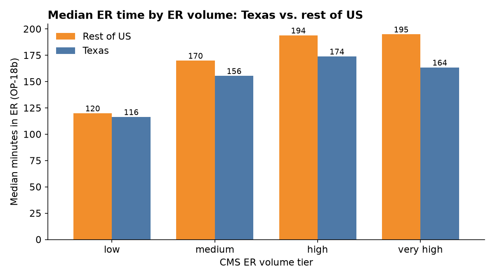
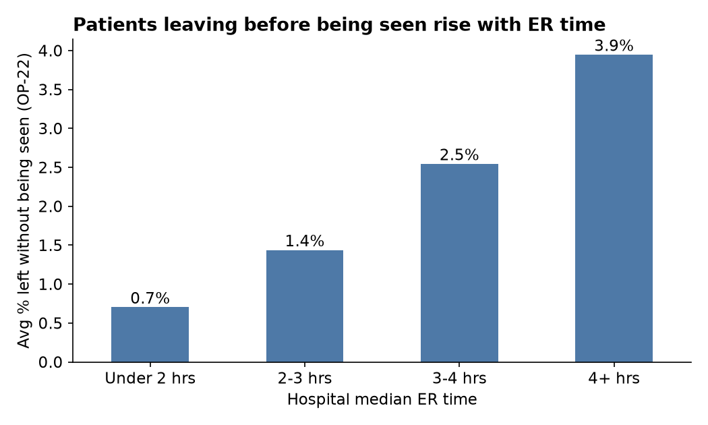

# Texas ER Wait Times vs. the Rest of the US

**Question:** How long do patients spend in Texas emergency rooms compared with the rest of the country, and which Texas ERs run slow even after you account for how busy they are?

**Data:** Real, public CMS Hospital Compare files (Care Compare, July 2026 release)
- [Timely and Effective Care - Hospital](https://data.cms.gov/provider-data/dataset/yv7e-xc69): OP-18b (median minutes in the ER), OP-22 (% who left before being seen), EDV (ER volume tier)
- [Hospital General Information](https://data.cms.gov/provider-data/dataset/xubh-q36u): hospital type, ownership, star rating

4,168 acute care and critical access hospitals with an ER, 360 of them in Texas. ER time covers Oct 2024 - Sep 2025.

**Tools:** SQL (SQLite) for all cleaning and analysis, Tableau for the dashboard.

---

## Key findings

1. **Texas ERs are faster than the national median: 137.5 min vs. 149 min.** The gap grows with ER size. At very high volume ERs Texas is 31 minutes faster (164 vs. 195 min).



2. **Long waits cost patients.** Nationally, hospitals where the median ER visit is over 4 hours lose 3.9% of patients before they are seen, vs. 0.7% at hospitals under 2 hours. That is more than 5x as many walkouts.



3. **45 of 283 Texas ERs are 30+ minutes slower than the US median for their volume tier** (13 are 60+ minutes slower). The top of the list is mostly large safety-net and teaching hospitals (Harris Health, University Health, Parkland), which see sicker, more complex patients. The volume tier does not capture that, so this list is a starting point for review, not a ranking.

4. **Austin-area ERs are in good shape.** 7 of 8 Austin-area hospitals with data are faster than their peer median (Baylor Scott & White Round Rock is 4 minutes over). St. David's South Austin and Round Rock Medical Center run 54-58 minutes faster than peers.

5. **Star rating is not a good proxy for ER speed.** In Texas, 2- through 5-star hospitals average 159-167 minutes. Ratings track walkouts a little better (2.2% at 1-star vs. 1.1% at 5-star).

## Recommendations

- Use the volume-adjusted scorecard (`output/tx_er_scorecard.csv`), not raw minutes, when comparing ERs. Raw minutes mostly reflect size.
- For the 13 "Review" hospitals, pair ER time with walkout rate. A slow ER with low walkouts is a different problem from a slow ER that is losing patients.
- Add a safety-net / trauma flag in the next version so the peer group is fairer.

## How I did it

| Step | File | What it does |
|---|---|---|
| 1 | `sql/01_load.sql` | Imports the two CMS CSVs into SQLite |
| 2 | `sql/02_clean.sql` | Converts "Not Available" to NULL, pivots measures to one row per hospital, groups ownership types |
| 3 | `sql/00_data_checks.sql` | Checks for duplicates, missing values, impossible values |
| 4 | `sql/03_analysis.sql` | Medians with window functions, volume-tier comparison, ownership, star rating, outlier scorecard |
| 5 | `sql/04_export.sql` | Writes CSVs for Tableau |

SQL concepts used: CTEs, `ROW_NUMBER()` / `COUNT() OVER (PARTITION BY ...)` for medians, conditional aggregation (`CASE` inside `MAX`/`AVG`) to pivot, joins, views.

**Data quality notes**
- 11.1% of Texas ERs have no OP-18b score (CMS suppresses small samples), vs. 6.3% elsewhere. These hospitals are excluded, not filled in.
- 67 Texas hospitals have no volume tier, so they drop out of the peer comparison (283 of 320 remain).

## Run it yourself

```bash
sqlite3 er.db < sql/01_load.sql
sqlite3 er.db < sql/02_clean.sql
sqlite3 er.db < sql/00_data_checks.sql
sqlite3 er.db < sql/03_analysis.sql
sqlite3 er.db < sql/04_export.sql
```

README charts are made by `charts.py` (pandas + matplotlib) from the output CSVs.

Tableau dashboard: see [tableau/README.md](tableau/README.md)

## Limitations

- OP-18b is a hospital-level median. It says nothing about individual patients or time of day.
- Ownership and star rating are associations, not causes.
